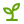
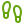
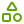
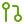

<!-- readme-standard: 2026-11-02 -->
<div align="center">



# Wilson's Lawn Maintenance: brand-assets

*The logo, the photos from the business's Facebook page, and who may use them.*


[](./LICENSE)
[](https://www.facebook.com/WilsonslawnmaintenancePA/)


 **You are here:** Wilson's Lawn Maintenance › `brand-assets` · public · `main` is the working branch

</div>

> **A draft, not the business's own wording and not legal advice.** The licence and trademark text here follows a shape
> other organisations in the lab's care use and has not been reviewed by a lawyer. Nothing here claims the business's
> endorsement until the business says so.

##  TL;DR

1.  **What this is.** The home for the logo and photos of Wilson's Lawn Maintenance (Glen Rock, PA), kept ready by Jeff's brother's lab as a gift. The business decides what stays here and is welcome to reshape it.
2.  **Who it is for.** The business itself; a customer who wants to say who did the work; a page or a print that shows the logo the right way.
3.  **Do this first.** Read [`BRAND-GUIDELINES.md`](BRAND-GUIDELINES.md) before using anything; where each picture came from is in [`PROVENANCE.md`](PROVENANCE.md).

##  Who owns the marks, and what may be done

**Wilson's Lawn Maintenance**, its logo and its tagline ("Keeping it green") belong to **Wilson's Lawn Maintenance**
(Jeffrey Wilson, Glen Rock, PA). No registration is claimed in these files.

- **You may** use the name factually, for example to say who mowed, mulched or plowed.
- **Customers and press** may use the logo as [`BRAND-GUIDELINES.md`](BRAND-GUIDELINES.md) describes.
- **Everything else needs the business's permission first:** merchandise, partnerships, commercial use, modified
  versions. Reach the business on [Facebook](https://www.facebook.com/WilsonslawnmaintenancePA/), by phone at
  (717) 825-8432, or by email at Wilsonj84321@gmail.com.

##  What's here

```
brand-assets/
├── README.md              ← you are here
├── BRAND-GUIDELINES.md    ← how to use (and not use) the marks
├── LICENSE                ← all rights reserved
├── TRADEMARKS.md          ← the name, logo and tagline
├── PROVENANCE.md          ← where every picture came from, and the three held back
├── PUBLIC-LANE-MEDIA.txt  ← the folder of pictures a person approved for the public lane
└── photos/                ← 31 pictures, named for what they show
```

| | File | What it is |
|---|---|---|
|  | `photos/logo-round-keeping-it-green.jpg` | the logo: a tree over a spade, mown rows below, the name on a banner, *Keeping it green* round the rim, on a black disc. 1000×1000, JPEG, flattened. The only logo file on hand; a master (SVG or layered) would settle colours and clear space |
|  | `photos/cover-landscaping-and-mowing-services.png` | the Facebook cover: a field at sunrise, *Landscaping services · Mowing services*, residential and commercial, with the phone and email the business prints |
|  | `photos/flyer-snow-removal-services.jpg`, `…-large.png` | the snow-removal flyer, two sizes: plowing and ice control, commercial and residential |
|  | the other 27 in `photos/` | the work: striped lawns, mulch beds and rings, stone edging, patios and walls, firewood stacked and delivered, the plow truck in snow. Each file name says what it shows |

Nothing here is a customer's name or address. A picture of a finished yard is a picture of the work.

##  Palette

**The logo**, sampled from the JPEG above, so close rather than official: a master file or the printer's specs would
settle them.

| Colour | HEX | Where |
|---|---|---|
| Leaf green | `#5a9e3a` | the tree, the mown rows |
| Earth brown | `#a0683a` | the spade, the inner ring |
| Black | `#1c1c1c` | the disc, the banner |
| White | `#ffffff` | the lettering |

**The pages here** (this organisation's own READMEs, badges and icons) wear a lawn green of the lab's choosing, not a
brand colour: `65a30d`, `365314`, `4d7c0f`, `ecfccb`.

<a id="roadmap"></a>
##  Roadmap

Whenever the business likes, and only if it likes:

- [ ] Read and correct the wording here.
- [ ] Swap the JPEG logo for a master file (SVG or layered), with light-background and dark-background versions.
- [ ] Confirm official colours and any typeface.
- [ ] Decide about the three pictures held back ([`PROVENANCE.md`](PROVENANCE.md)).

##  Suggest a change

Noticed something? Open an [issue](../../issues) or a pull request against `main`. Christopher and the drasticstatic lab read them, the business decides what is said about it, and a person with the role merges with a merge commit. Not on GitHub? One message to Christopher is enough.

<sub>This front door follows the living [README standard](https://github.com/drasticstatic/my-template/blob/main/README-STANDARD.md). Copy it, improve it. Everything in `photos/` is all rights reserved ([`LICENSE`](LICENSE)); the name, logo and tagline are covered by [`TRADEMARKS.md`](TRADEMARKS.md). Icons: Lucide (ISC), see <code>assets/icons/LICENSE</code>.</sub>
